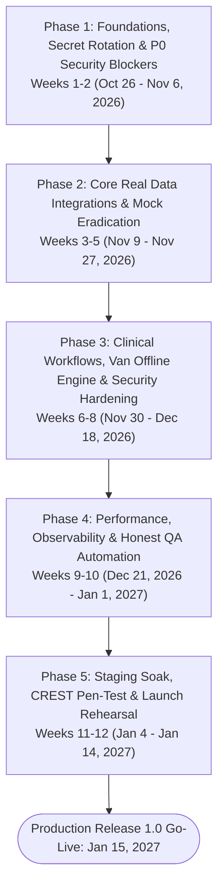
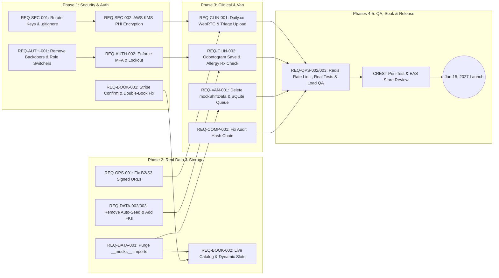

# Production Master Execution Blueprint: Pav Dental
**Audit & Plan Baseline Date:** October 23, 2026  
**Target Production Launch Date:** January 15, 2027 (12-Week Execution Blueprint) **[ASSUMPTION]**  
**Team Size & Roles:** 6 Engineers (1 Principal/Tech Lead, 2 Senior Backend Engineers, 2 Senior Mobile Engineers, 1 DevOps/SecOps/QA Automation Engineer) **[ASSUMPTION]**  
**Target Region & Scale:** AWS `eu-west-2` (London), 10,000 Active Patients, 50 Concurrent Clinicians/Vans, 100 Sustained RPS / 250 Peak RPS **[ASSUMPTION]**

---

## 1. Reverse-Engineered Timeline & Phased Milestones (Oct 23, 2026 → Jan 15, 2027)

---

### Phase 1: Foundations, Secret Rotation & P0 Security Blockers (Weeks 1–2: Oct 26 – Nov 6, 2026)
**Objective:** Rotate exposed credentials, lock down authentication/MFA/IDOR bypasses, fix payment confirmation vulnerabilities, and repair CI/PostGIS pipelines.
- **SecOps / DevOps (`REQ-SEC-001`, `REQ-OPS-003`):**
  - Immediately rotate exposed Stripe (`sk_live_*`), Backblaze B2, and Daily.co keys found in `backend/.env:18-33`; add `uploads/` and `testsprite_tests/tmp/` to `.gitignore`; purge `backend/uploads/gdpr-sar/*` and `backend/uploads/plans/*`.
  - Upgrade `.github/workflows/ci.yml:22, 72` to `postgis/postgis:16-3.4-alpine` and replace `prisma db push` with `npx prisma migrate deploy`.
  - Add non-root `USER node` to `backend/Dockerfile:35` and provision AWS `eu-west-2` staging infrastructure (ECS Fargate, RDS PostgreSQL/PostGIS, ElastiCache Redis, KMS CMK, Secrets Manager).
- **Backend (`REQ-AUTH-002`, `REQ-SEC-003`, `REQ-SEC-004`, `REQ-BOOK-001`):**
  - Enforce `user.mfaEnabled` and mandatory MFA for `clinician`/`admin` in `POST /api/auth/login` (`auth.ts:147-161`) and mount `requireMFAForRoles(["clinician", "admin"])` (`middleware/mfa.ts:139`).
  - Enforce `user.lockedUntil` check in `POST /api/auth/otp/verify` (`auth-otp.ts:85-87`) and remove `role` leakage from `POST /api/auth/check-email` (`auth.ts:28`).
  - Fix IDOR vulnerabilities in `video.ts:32-168, 230`, `prescriptions.ts:38-45, 103`, `payments.ts:140`, and `notifications.ts:27-38`.
  - Fix `PATCH /api/booking/appointments/:id/confirm` (`booking.ts:265-329`) to verify `stripe.paymentIntents.retrieve(stripePaymentId)` and fix the `result.httpStatus` 500 crash (`line 324`); add double-booking check to `POST /api/booking/appointments` (`booking.ts:166-179`).
  - Restrict triage photo uploads (`video.ts:22`) to magic-byte verified `jpeg`/`png`/`webp` and set `Content-Disposition: attachment` on `/api/patients/documents/stream/*` (`server.ts:139`).
- **Mobile Frontend (`REQ-AUTH-001`, `REQ-AUTH-003`):**
  - Delete `"123456"` catch block backdoor in `verify-email.tsx:32`.
  - Delete unguarded role-switcher cards in `profile/index.tsx:156-202`, `schedule.tsx:153-187`, and `route.tsx:339-373`.
  - Fix `(auth)/_layout.tsx:13-21` post-registration redirect race so new users complete `verify-email` and `/(onboarding)/*`.
  - Normalize `pavdental/package.json:18-51` dependency versions and add missing Android permissions/plugins to `pavdental/app.json:26-55`.
- **Milestone 1 Exit Gate (Nov 6, 2026):** Zero exposed secrets; zero client/server auth or payment bypasses; CI running full PostGIS migrations cleanly.

---

### Phase 2: Core Real Data Integrations & Mock Eradication (Weeks 3–5: Nov 9 – Nov 27, 2026)
**Objective:** Purge all `src/__mocks__/*` imports, auto-seeded backend fake records, hardcoded service catalogs, and broken object storage links.
- **Mobile Frontend (`REQ-DATA-001`, `REQ-BOOK-002`):**
  - Remove all imports of `@/__mocks__/*` across the 11 patient screens (`(tabs)/appointments.tsx`, `appointments/[id].tsx`, `check-in.tsx`, `records/plans.tsx`, `records/plans/[id].tsx`, `records/odontogram.tsx`, `records/vault.tsx`, `booking/clinic-picker.tsx`, `clinician-picker.tsx`, `provider-profile.tsx`, `slot-picker.tsx`) and `clinician/schedule.tsx`; wire `<EmptyState />` and `<ErrorState />`.
  - Wire `booking/service-catalog.tsx:34-182` and `(tabs)/home.tsx:42-234` to live `useServices()` data with active category and search filtering.
  - Replace hardcoded September 2026 dates in `booking/slot-picker.tsx:17-31` with dynamic rolling 14-day dates and remove the fake offline hold timer (`line 76`).
  - Fix `MedicalHistoryForm.tsx:145-146` chip text concatenation, `notifications.tsx:19-24` async state initialization, `onboarding/consents.tsx:83` stale `directMarketing` state, and `stripe-web-shim.js:8-15`.
- **Backend (`REQ-DATA-002`, `REQ-DATA-003`, `REQ-FIN-001`, `REQ-OPS-001`):**
  - Remove auto-seeded demo message threads from `GET /api/messages` (`messages.ts:38-99`) and enable clinician thread access/replies.
  - Remove hardcoded `pointsBalance: 1450` / `12%` plaque / `4%` bleeding initialization in `rewards.ts:70-88` and wrap `POST /api/rewards/redeem` (`rewards.ts:120-143`) in an atomic balance guard.
  - Add the 9 missing foreign key `@relation` constraints in `backend/prisma/schema.prisma` and normalize `seed.ts:397-428` odontogram quadrants.
  - Remove `isMockStripe` (`payments.ts:13`, `van.ts:38`, `cancellations.ts:11`, `van-payments.ts:15`).
  - Fix `objectStorage.getSignedUrl` (`object-storage.ts:212-222`) to use S3 SigV4 presigned URLs or `/api/patients/documents/stream/*`.
- **Milestone 2 Exit Gate (Nov 27, 2026):** Zero `@/__mocks__/*` imports in production code; new patients see clean empty states; live booking and document downloads work end-to-end.

---

### Phase 3: Clinical Workflows, Van Offline Engine & Security Hardening (Weeks 6–8: Nov 30 – Dec 18, 2026)
**Objective:** Complete real Daily.co video consultations, clinician odontogram/Rx workflows, van operator SQLite offline sync, KMS PHI encryption, and tamper-evident audit logging.
- **Full Stack Clinical & Telehealth (`REQ-CLIN-001`, `REQ-CLIN-002`):**
  - Wire `video/intake.tsx`, `photos.tsx`, `photo-review.tsx`, `device-check.tsx`, `waiting.tsx`, `call.tsx`, and `summary.tsx` to real camera capture, `/api/video/upload-triage-photo`, `/api/video/submit-triage`, and `@daily-co/react-native-daily-js` WebRTC media streams.
  - Wire `clinician/consult-room.tsx:210-342` to load live `triageData` and `useOdontogram(patientId)`, and save tooth chart changes via `PUT /api/patients/:id/odontogram`.
  - Wire `clinician/rx-dispense.tsx:19-79` to live patient profile/allergies, enforce penicillin allergy contraindication checks, surface API errors, and integrate accredited UK e-prescribing gateway in `prescriptions.ts:48-55`.
  - Enforce `LocalAuthentication.authenticateAsync()` on `records/plans/[id].tsx:447-465` and remove error-swallowing catch blocks (`lines 98-141`).
- **Mobile Van Operations (`REQ-VAN-001`, `REQ-SEC-002`):**
  - Delete `mockShiftData` from `pavdental/src/features/van/van-api.ts:144-500`.
  - Implement encrypted `expo-sqlite` offline mutation queue in `pavdental/src/app/(operator)/offline-capture.tsx:40-57` with automatic background sync.
  - Call `decryptAccessDetails` on accepted operator queue stops in `backend/src/routes/van.ts:359-424, 1049-1053`.
- **Backend Security & Compliance (`REQ-SEC-002`, `REQ-COMP-001`):**
  - Integrate `@aws-sdk/client-kms` in `backend/src/lib/encryption.ts` and encrypt `medicalHistory`, `triageData`, `ToothRecord.notes`, `Message.body`, and GDPR SAR bundles at rest.
  - Fix `createAuditLogWithIntegrity` (`audit-integrity.ts:24, 38-46`) timestamp drift, convert all 16 direct `prisma.auditLog.create` calls to `createAuditLogWithIntegrity`, and fix `BigInt` serialization in `GET /api/audit/logs` (`routes/audit.ts:49`).
- **Milestone 3 Exit Gate (Dec 18, 2026):** All 4 portals operate 100% on real encrypted data; `GET /api/audit/integrity` passes with 0 tampered/unhashed logs; van offline capture survives connectivity loss.

---

### Phase 4: Performance, Observability & Honest QA Automation (Weeks 9–10: Dec 21, 2026 – Jan 1, 2027)
**Objective:** Replace tautological tests with comprehensive integration/E2E suites, wire structured logging and Sentry/APM, and optimize Redis/DB hot paths.
- **Backend & DevOps (`REQ-OPS-002`):**
  - Replace in-memory `express-rate-limit` (`server.ts:76-89`) with `rate-limit-redis`.
  - Optimize `GET /api/booking/slots` (`booking.ts:59-64`) with `redis.mget` and interval overlap queries; eliminate N+1 `count` query in `GET /api/waitlist` (`waitlist.ts:82-93`).
  - Wire `StructuredLogger` and `correlationIdMiddleware` (`structured-logging.ts:1-310`) across all routes and clear background `setInterval` timers on graceful shutdown (`server.ts:206`).
  - Integrate `@sentry/node`, `@sentry/react-native`, and OpenTelemetry tracing with PII redaction.
- **QA & Engineering (`REQ-OPS-003`):**
  - Rewrite `backend/src/__tests__/auth-integration.test.ts` and `background-jobs.test.ts` to test real Express routes (`supertest`) and background workers; fix `e2e-suite.ts:248-252` to assert `200 OK` on `/api/dspt/dspt-report` with an admin token.
  - Rewrite `pavdental/run-tests.ts` and `pavdental/src/__tests__/*` to test real components, hooks, and stores; remove `src/__tests__` exclusion from `pavdental/tsconfig.json:25`.
  - Execute `k6` load testing at 100 sustained RPS / 250 peak RPS verifying `p95 < 250ms` and `p99 < 500ms`.
- **Milestone 4 Exit Gate (Jan 1, 2027):** >80% real backend/frontend test coverage; 0 failed or skipped CI tests; load test SLA targets met.

---

### Phase 5: Staging Soak, Penetration Testing & Launch Rehearsal (Weeks 11–12: Jan 4 – Jan 14, 2027)
**Objective:** External security validation, regulatory sign-off, App Store / Play Store binary approval, and disaster recovery verification.
- **Security & Compliance:**
  - Conduct independent CREST-accredited penetration test across mobile binaries and backend APIs; remediate any Medium+ findings.
  - Complete NHS DSPT Category 1 evidence submission, DPIA sign-off, and Clinical Safety Case Report (DCB0129 / DCB0160).
- **Release Management:**
  - Submit production iOS and Android binaries via Expo EAS to Apple App Store Connect and Google Play Console.
  - Execute 72-hour staging soak test and RDS Point-in-Time Recovery (PITR) drill verifying `RTO < 15 minutes` and `RPO < 5 minutes`.
  - Conduct final Go/No-Go launch review on January 14, 2027.

---

## 2. Dependency Graph & Critical Path

### Critical Path Bottlenecks:
1. **Credential Rotation & KMS Provisioning (Week 1):** Blocks encrypted PHI storage (`REQ-SEC-002`) and live Stripe/Daily.co/Backblaze B2 verification.
2. **Purging `@/__mocks__/*` & Auto-Seeded DB Rows (Weeks 3–4):** Prerequisite before any realistic E2E clinical or booking test can run.
3. **Daily.co Native WebRTC & Van SQLite Offline Engine (Weeks 6–8):** Highest mobile engineering complexity and requires native dev client builds via Expo EAS.
4. **Apple App Store / Google Play Healthcare Review & CREST Pen-Test (Weeks 11–12):** External lead times that require feature freeze by January 1, 2027.

---

## 3. Work-Stream Allocation (6-Engineer Team)

| Engineer Role | Weeks 1–2 (Phase 1) | Weeks 3–5 (Phase 2) | Weeks 6–8 (Phase 3) | Weeks 9–12 (Phases 4–5) |
| :--- | :--- | :--- | :--- | :--- |
| **Principal Engineer / Tech Lead** | `REQ-SEC-001` key rotation, `REQ-SEC-003` IDOR fixes, architecture governance | `REQ-SEC-002` KMS field encryption design & implementation | `REQ-COMP-001` audit hash chain fix, e-prescribing gateway | Pen-test remediation, DCB0129 safety sign-off, Go/No-Go |
| **Senior Backend Engineer 1** | `REQ-AUTH-002` MFA login & route enforcement, `lockedUntil` OTP fix | `REQ-DATA-002` remove message/reward auto-seeds, clinician chat API | `REQ-CLIN-001/002` video/odontogram/Rx API hardening | `REQ-OPS-002` `StructuredLogger` rollout, real `auth-integration.test.ts` |
| **Senior Backend Engineer 2** | `REQ-BOOK-001` Stripe confirm verification, double-booking lock, `REQ-SEC-004` | `REQ-FIN-001` remove `isMockStripe`, `REQ-OPS-001` B2/S3 signed URLs, `REQ-DATA-003` FKs | `van.ts:359-424` operator `decryptAccessDetails`, GDPR CSV export | `REQ-OPS-002` Redis rate limiter, `booking/slots` `mget`, `k6` load testing |
| **Senior Mobile Engineer 1 (Patient & Clinician)** | `REQ-AUTH-001` remove `"123456"` backdoor & role switchers, fix `(auth)/_layout.tsx` | `REQ-DATA-001` purge `@/__mocks__/*` in patient/clinician screens, `REQ-BOOK-002` live catalog/slots | `REQ-CLIN-001` Daily.co WebRTC `call.tsx` & triage upload, `REQ-CLIN-002` `consult-room.tsx` & `rx-dispense.tsx` | Mobile Jest & Playwright E2E suite, Sentry React Native, App Store submission |
| **Senior Mobile Engineer 2 (Van & Account)** | `REQ-AUTH-003` unify biometric stores, fix `reset.tsx`, `package.json` & `app.json` | Fix `MedicalHistoryForm.tsx`, `notifications.tsx`, `consents.tsx`, `stripe-web-shim.js` | `REQ-VAN-001` delete `mockShiftData` in `van-api.ts`, build `expo-sqlite` offline capture queue | Offline sync chaos testing, Android Play Store submission, bug bash |
| **DevOps / SecOps / QA Engineer** | `REQ-OPS-003` PostGIS CI + `prisma migrate deploy`, `Dockerfile` non-root, Terraform AWS | Provision AWS `eu-west-2` staging ECS/RDS/Redis/S3, Secrets Manager | Sentry & OpenTelemetry pipelines, automated backup/PITR setup | Rewrite tautological tests, execute 72h staging soak & DR drill |

---

## 4. Risk Management Register & Go/No-Go Criteria

| Risk ID & Description | Likelihood | Impact | Mitigation Strategy | Rollback Procedure |
| :--- | :---: | :---: | :--- | :--- |
| **R-01: NHS Digital Spine EPS Accreditation Delay** | High | High | Integrate an already-accredited UK private/NHS e-prescribing intermediary API (SignatureRx / CloudRx) for Launch 1.0 while direct NHS Spine onboarding proceeds in parallel. | Disable direct pharmacy transmission and issue GDC-compliant digitally signed prescription PDFs with verifiable QR codes. |
| **R-02: FCA Regulatory Scope on 0% APR Financing** | Medium | High | Route `POST /api/financing/apply` to an FCA-authorized broker hosted checkout (Chrysalis Finance / Klarna) rather than making automated credit decisions inside Pav Dental. | Switch financing screen to a static calculator + `"Request Callback from Treatment Coordinator"` lead form (`status: "submitted_under_review"`). |
| **R-03: Native WebRTC (`@daily-co/react-native-daily-js`) Build Issues on Expo** | Medium | High | Lock Expo SDK version to a verified LTS release (SDK 52) in Week 1 and generate custom Expo EAS development builds early in Phase 2. | Fall back to opening signed, time-limited Daily.co Prebuilt rooms inside an authenticated `expo-web-browser` session with webhook admission gating. |
| **R-04: Historical Plaintext Database Rows During KMS Encryption Migration** | Medium | Critical | Support dual-read in `clinicalRecordEncryptionService` during migration and run an idempotent background migration script encrypting existing plaintext JSON/text rows. | Restore RDS snapshot prior to migration and re-run batch encryption in read-only maintenance window. |
| **R-05: Van Operator Offline Sync Conflicts** | Medium | Medium | Assign client-generated UUID idempotency keys and monotonic timestamps to every `expo-sqlite` queued phase transition and clinical note. | Flag conflicting offline records in admin dashboard for clinician review without discarding note text. |

### Mandatory Go / No-Go Launch Criteria (January 14, 2027):
1. **Security Gate:** Zero Critical or High vulnerabilities open; all exposed keys rotated; `GET /api/audit/integrity` returns `valid: true`.
2. **Data Integrity Gate:** Zero imports from `@/__mocks__/*` in `pavdental/src/app/**`; zero `mockShiftData` or `isMockStripe` code paths remaining.
3. **Clinical Safety Gate:** Penicillin allergy contraindication block verified in `rx-dispense.tsx`; odontogram and triage data persist and encrypt end-to-end.
4. **Reliability Gate:** 72-hour staging soak with `< 0.1%` 5xx error rate, `p95 < 250ms` at 100 RPS, and verified 15-minute RDS PITR recovery.

---

## 5. Infrastructure & Third-Party Monthly Cost Estimate

### Target Launch Scale: Single-Region (`eu-west-2`), 10,000 Active Patients, 50 Clinicians/Vans, 100 RPS

| Category | Service / Provider | Sizing & Tier | Est. Monthly Cost (USD) |
| :--- | :--- | :--- | :---: |
| **Compute** | AWS ECS Fargate (`eu-west-2`) | 4 tasks × (1 vCPU, 2 GB RAM) across 2 AZs + ALB | \$195 |
| **Database** | AWS RDS PostgreSQL 16 + PostGIS | `db.m6g.large` Multi-AZ, 200 GB gp3, 35-day PITR backups | \$385 |
| **Cache & Locks** | AWS ElastiCache for Redis 7 | `cache.t4g.medium` Multi-AZ with automatic failover | \$115 |
| **Storage & Crypto** | Backblaze B2 / AWS S3 + AWS KMS | 500 GB encrypted clinical vault + 2 KMS CMKs + API calls | \$45 |
| **Telehealth Video** | Daily.co WebRTC API | ~15,000 participant minutes/month | \$180 |
| **Communications** | SendGrid (Pro) + Twilio UK SMS | 50,000 transactional emails + 8,000 OTP/alert SMS | \$390 |
| **Geolocation** | Mapbox Matrix & Directions API | Live van ETA matrix & route optimization (~150k reqs/mo) | \$120 |
| **Observability** | Sentry Team + CloudWatch Logs/APM | Mobile + Backend crash reporting, structured logs, alarms | \$160 |
| **Mobile CI/CD** | Expo Application Services (EAS) | Production plan (iOS/Android cloud builds + OTA updates) | \$99 |
| **Payments** | Stripe UK | Standard UK card processing (1.5% + 20p) | *Pass-through* |
| **TOTAL** | | **Estimated Monthly Production Run-Rate** | **\$1,689 / month** |

---

## 6. Scope Adjustments & Explicit Trade-Offs for Launch 1.0

To hit the **January 15, 2027** launch date safely with a 6-engineer team while dedicating full capacity to P0 clinical, security, and payment blockers, the following non-essential features are de-scoped from Release 1.0 and deferred to Release 1.1 (Q2 2027):

1. **Automated Optical Character Recognition (OCR) for Insurance Cards (`(onboarding)/insurance.tsx:21-36`, `booking/insurance.tsx:48`)**
   - *Trade-off Decision:* Replace the fake OCR scanner with a simple manual policy number/provider form and optional card photo upload to `DocumentVault` for front-desk verification.
   - *Justification:* Avoids integrating and validating third-party OCR Vision APIs across dozens of UK dental insurers while preserving 100% of booking functionality.

2. **Smart Bluetooth Toothbrush Telemetry & Gamified Partner Perks Store (`records/insights.tsx:162-173`, `perks.tsx:19-254`)**
   - *Trade-off Decision:* Remove hardcoded `"Philips Sonicare connected"` telemetry and partner promo codes (`PAVBOOTS15`); scope `insights.tsx` strictly to clinician-recorded Plaque Index and Bleeding scores from actual appointments.
   - *Justification:* Hardware Bluetooth SDKs and retail loyalty ledgers carry zero clinical value and currently inject fabricated clinical data (`12%` plaque, `1450` pts) into patient records.

3. **Real-Time Map Tile Rendering for Patient Van Tracking (`van/live-track.tsx:214-237`)**
   - *Trade-off Decision:* Retain the live-polled ETA countdown, stop queue position, and status timeline (`en_route` -> `arriving` -> `on_site`) from `GET /api/van/requests/mine/active` while deferring embedded `react-native-maps` vector tile rendering to v1.1 (operators already use native Apple/Google/Waze turn-by-turn navigation via `nav-links.ts:1-60`).
   - *Justification:* Eliminates native Google Maps / Apple MapKit SDK build risk on iOS/Android while still delivering accurate, real-time Mapbox-calculated ETAs and push notifications.

4. **Guest Browsing Mode (`(auth)/guest-limit.tsx:1-62`)**
   - *Trade-off Decision:* Delete unreachable `guest-limit.tsx` and require authentication prior to accessing clinical booking and telehealth flows.
   - *Justification:* Healthcare booking requires verified patient identity and GDPR consent prior to collecting symptom triage or medical history.
