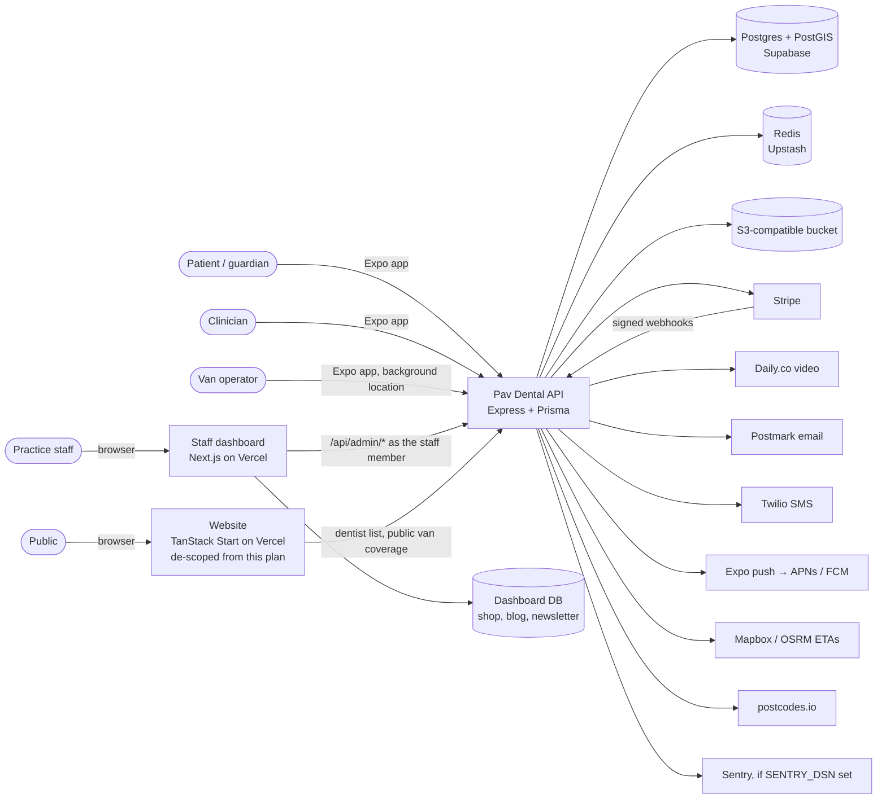
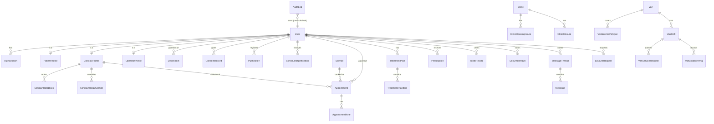
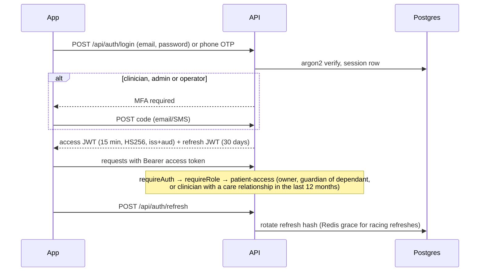
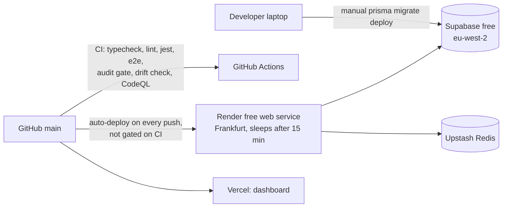
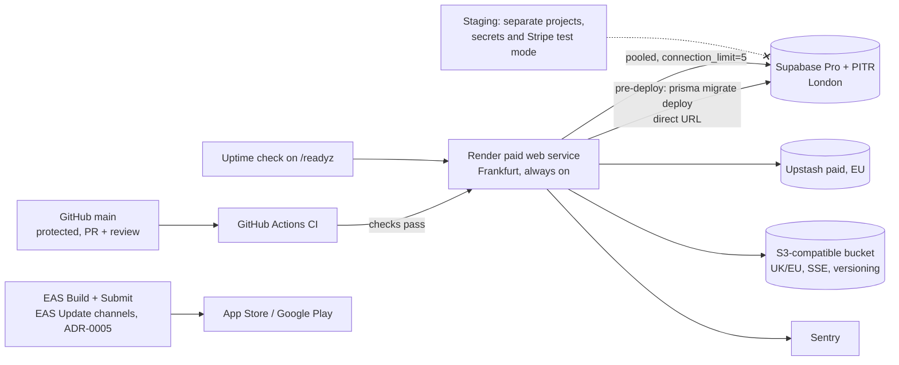

# Pav Dental: architecture

> Checked against `main` @ `ff31b90` on 27 Oct 2026 (replaces the 26 Sep version). Sections marked **Current** describe code that exists and runs in CI; sections marked **Proposed** describe the production set-up the plan is working towards (ADRs in [`docs/adr/`](docs/adr/)). Findings and their evidence are in [`docs/completion/07-architecture-audit.md`](docs/completion/07-architecture-audit.md); the work list is [`docs/completion/06-completion-plan.md`](docs/completion/06-completion-plan.md).

## 1. Requirements in brief

**Functional.** Patients book clinic visits, home visits by the mobile van and video consultations, pay a deposit by card, keep a record of treatment plans, prescriptions and documents, message the practice, and manage consent, dependants, data access requests and account deletion. Clinicians run their schedule, consult room, notes, odontogram, treatment plans and prescriptions. Van operators run a shift: incoming requests, route, check-in, offline visit notes and live location. Staff use the web dashboard for the rota, services, clinics, vans, dentist profiles, inbox, erasure requests and referral vouchers.

**Non-functional (targets from ADR-0003).** One private practice, up to ~1,000 active patients in year one, peak ≤ 50 requests/second. API availability 99.5% a month, RPO ≤ 5 minutes, RTO ≤ 4 hours, p95 read latency < 500 ms. Health data is UK GDPR special category data: encrypted at rest, minimised in logs, audited, retained per decision #9.

**Constraints.** A one-person owner with Claude doing most engineering; small monthly budget (D-10); Render in Frankfurt (decision #19); UK/EU data residency; private practice only (D-13).

## 2. System context (Current)



The API is the only owner of patient and clinical data (ADR-0001). The dashboard has its own small database for website content only.

## 3. Components and responsibilities (Current)

| Component | Folder | Responsibility | Stack |
|---|---|---|---|
| API | `backend/` | Auth, booking, payments, van dispatch, video rooms, records, prescriptions, consent, messaging, audit, background jobs | Node 22 (ADR-0004), Express 4, Prisma 6, zod 4, argon2, Stripe, ioredis |
| Mobile app | `pavdental/` | Patient, clinician and operator portals (route groups `(patient)`, `(clinician)`, `(operator)`, `(auth)`, `onboarding`) | Expo SDK 57, React Native 0.86, Expo Router, TanStack Query, Zustand, Stripe RN, Sentry RN |
| Staff dashboard | `admin-dashboard/` | Back office for app data (through the API) and website content (own DB) | Next.js 16, shadcn/ui |
| Website | `website/` | Marketing site and shop; hosts the privacy/terms pages the app links to | TanStack Start, Vite |

Inside the API, `routes/` hold HTTP handlers, `middleware/` holds auth, role and patient-access checks, audit and rate limits, and `lib/` holds services (availability, payments, encryption, audit integrity, erasure, SAR export, van ETA and coverage, background jobs).

## 4. Data model (Current, main entities)

49 Prisma models, 41 migrations, drift-checked in CI.



Integrity rules live in the schema and in transactions: booking uses advisory locks and compare-and-set to stop double booking; Stripe events are de-duplicated in `processed_stripe_events`; the audit log is a hash chain verified on boot and on demand; selected health fields are envelope-encrypted with a versioned key (`lib/encryption.ts`).

## 5. Key journeys (Current)

### 5.1 Book a clinic appointment with a deposit

```mermaid
sequenceDiagram
  participant App
  participant API
  participant DB as Postgres
  participant R as Redis
  participant S as Stripe
  App->>API: GET availability (service, clinic, date)
  API->>DB: rota, overrides, closures, existing bookings
  App->>API: POST hold slot
  API->>R: SET NX EX slot lock (hold with TTL)
  App->>API: POST confirm (idempotency key)
  API->>DB: re-check slot is free, create appointment awaiting deposit
  API->>S: create PaymentIntent (deposit)
  App->>S: PaymentSheet (card / Apple Pay / Google Pay)
  S-->>API: webhook payment_intent.succeeded (signed, raw body)
  API->>DB: dedupe event id, appointment=confirmed, schedule reminders
  Note over API,DB: background job expires unpaid holds;<br/>late deposit after expiry is auto-refunded (decision #7)
```

### 5.2 Van home visit

Coverage check (PostGIS polygon, or JS fallback) → live availability and ETA (Mapbox/OSRM or haversine fallback) → access details (door codes, encrypted) → deposit authorised with manual capture → operator accepts (captured, appointment linked) → `en_route` → `on_site` → `in_treatment` → `completed`. Patients get ETA pushes when the estimate drifts. Refund rules per decision #6.

### 5.3 Video consultation

Intake and photos (uploaded to the bucket) → device check → waiting room → the API creates a Daily room and a short-lived meeting token → the call opens in the phone's browser (D-01) → clinician writes the summary.

### 5.4 Sign-in and authorisation



Tokens are stored in the device's secure store. Biometric unlock gates the app locally; it does not replace the server session.

## 6. Background work (Current; ADR-0002)

| Job | Interval | Safe with two instances? |
|---|---|---|
| Expire slot holds, rewards and referral catch-up | minutes | holds: row claims; catch-up not verified |
| Dispatch scheduled reminders | minutes | holds: `FOR UPDATE SKIP LOCKED`; lease added 26 Oct (BE-22) |
| Expire van requests, retry deposit releases | minutes | holds: advisory lock per shift |
| Retention sweep (reports only unless `RETENTION_ENFORCE=true`) | daily | not verified |
| Expo push receipts | 15 min | not verified |
| Audit chain monitoring | on boot and timer | read-only |

All jobs run inside the API process, so the API must be always-on.

## 7. Deployment topology

### 7.1 Current (test only)



### 7.2 Proposed production (ADR-0003, ADR-0006)



Environments are separate accounts or projects with separate secrets. Staging never connects to production data. Stripe is test mode outside production (`config/env.ts` enforces this).

## 8. Security boundaries and sensitive data flows

| Boundary | Control (Current) |
|---|---|
| Internet → API | TLS at Render; helmet; CORS allow-list (native apps send no Origin); global and auth rate limits in Redis; 2 MB body limit; zod validation |
| Authentication | argon2 hashes, JWT HS256 with issuer/audience, session revocation, MFA for staff and operators |
| Authorisation | role middleware plus patient-access checks (owner, guardian, clinician care relationship) on every patient-scoped route |
| Health data at rest | Postgres encryption at rest (provider) plus field-level envelope encryption for sensitive fields; bucket server-side encryption |
| Documents | bucket objects served through short-lived HMAC-signed URLs with `Content-Disposition: attachment` and a sandbox CSP |
| Logs and errors | `safeError` and scrubbers keep personal data out of logs and Sentry; Prisma query logging off by default |
| Device | tokens in the secure store; biometric lock; screenshots blocked on clinical screens (D-14) |
| Third parties | Stripe sees card data only (PCI scope stays with Stripe); Daily sees video; Postmark/Twilio see contact details and codes; staff alert emails contain no patient name (D-19); push text is neutral on the lock screen |

Sensitive flows to watch when changing code: medical history and notes (encrypted fields), van access details (door codes, encrypted), prescriptions (sealed PDFs), SAR exports (signed, short-lived), operator location pings (deleted after 30 days once retention is enforced).

## 9. Failure scenarios and recovery

| Failure | Effect today | Recovery / mitigation |
|---|---|---|
| API process restarts mid-reminder | Fixed 26 Oct: claimed reminders are re-queued after a 15-minute lease | Alert on job lag (OPS-04) |
| API asleep (free tier) | No reminders, holds don't expire | Always-on paid instance (ADR-0003) |
| Redis down | Rate limits fail open; slot holds and refresh grace degrade; `/readyz` reports 503 | Upstash paid; alert on `/readyz` |
| Postgres down | API returns errors; `/readyz` 503 | Provider failover; PITR restore (RTO 4 h) |
| Stripe webhook delayed or repeated | De-duplicated; late deposit after hold expiry is refunded | Stripe retries for days |
| Daily, Postmark, Twilio, Expo push down | Calls time out after 5–10 s; the user sees an error; reminders retry up to 3 times | Status pages; Sentry alerts |
| Bad deploy | Everything down (single service) | Redeploy previous build in Render; migrations are expand-only (ADR-0006) |
| Bad app release | Store resubmission only | EAS Update rollback once ADR-0005 is adopted |
| Data deleted by mistake | Daily backup (free tier) | PITR (ADR-0003) and a tested restore (OPS-05) |

## 10. Scaling assumptions and bottlenecks

- One API instance handles the expected load; the first limit is the database pool (AUD-10), not CPU.
- Availability and ETA calculations are the heaviest reads; ETA results are cached per leg with a circuit breaker on the routing provider.
- The van queue is capped at 5 stops, so route optimisation by permutation stays cheap.
- Before adding a second API instance: job leadership (BE-23) and a load test (BE-19).

## 11. Local development

```bash
docker compose up -d        # Postgres (PostGIS) + Redis
cd backend
npm ci && npx prisma generate
npx prisma migrate deploy   # 41 migrations
npm run prisma:seed         # synthetic clinics, clinicians, services, van
npm run dev
npx jest                    # unit and integration (65 suites)
npm test                    # e2e (34 flows, mock Stripe, stubbed postcodes/Daily)

cd ../pavdental
npm ci
npx tsc --noEmit && npm run lint && npm run test:all
```

Without PostGIS the API still runs: van coverage falls back to JS ray-casting and logs which mode is active.
